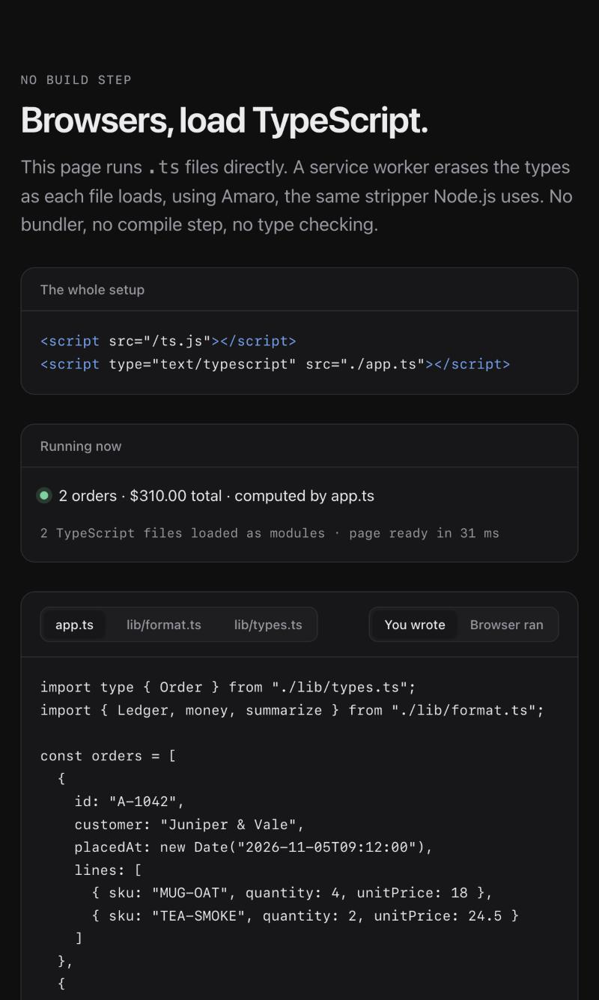

# loadts

Load TypeScript files in any modern browser. No build step, no bundler.

```html
<script src="/ts.js"></script>
<script type="text/typescript" src="./app.ts"></script>
```

That's the whole setup. `app.ts`, and every `.ts` file it imports, runs as a normal ES module.

**Live demo:** https://thisisezra.github.io/loadts/



## Why

Node, Deno and Bun already run `.ts` files directly. Browsers still don't: the
[TC39 type annotations proposal](https://github.com/tc39/proposal-type-annotations) has sat at
Stage 1 since 2022. loadts shows how little it takes. It erases types on the fly, the same way
Node does, and works in Chrome, Firefox and Safari today.

## How it works

`ts.js` registers a service worker, `ts-sw.js`. The worker intercepts requests for `.ts` and
`.mts` files on your own origin, erases the types, and returns plain JavaScript. The eraser is
[Amaro](https://github.com/nodejs/amaro), the type stripper built into Node.js, bundled for the
browser as `ts-strip.js`.

- **Types are erased, not checked.** Keep `tsc --noEmit` in your editor or CI.
- **Positions are kept.** Types become whitespace, so line and column numbers in errors match
  your source.
- **Node's strip-only rules apply.** Features that generate runtime code (`enum`, `namespace`
  with values, parameter properties) fail with a clear error.
- **`.d.ts` files are never touched.** Add `?raw` to any `.ts` URL to fetch the original source.

## Install

Copy the three files from `dist/` to the root of your site:

```
ts.js
ts-sw.js
ts-strip.js
```

Then add the two script tags above to your page. A service worker only controls pages at or below
its own folder, so the site root covers everything.

## Good for

Prototypes, demos, teaching, internal tools and small sites. For high-traffic production sites,
strip types once at build time instead: with loadts, every visitor downloads the stripper and
does the work in their own browser.

## Requirements

- **HTTPS or localhost.** Service workers need a secure origin.
- **A first-visit download.** `ts-strip.js` is about 2.9 MB of WebAssembly. It is fetched once and
  cached.
- **No reload needed.** On the first visit the loader waits a fraction of a second for the worker
  to take control, then imports your files.

## Tested

| Browser | First visit | Reload | `enum` rejected |
|---|---|---|---|
| Chrome 152 | pass | pass | pass |
| Firefox 159 | pass | pass | pass |
| Safari 18.5 | pass | pass | pass |

`docs/test.html` runs these checks. It loads the demo, confirms that an `enum` is rejected,
reloads once, and reports both visits to `/__report`, where they show in the server log.

## Develop

```bash
npm install
npm run build
npm run demo
```

`npm run build` bundles Amaro into `dist/ts-strip.js` and copies the three files into `docs/`.
`npm run demo` serves `docs/` at http://localhost:8977.

## License

MIT. `ts-strip.js` bundles Amaro (MIT) and SWC (Apache-2.0); see
[THIRD-PARTY-LICENSES.md](THIRD-PARTY-LICENSES.md).
